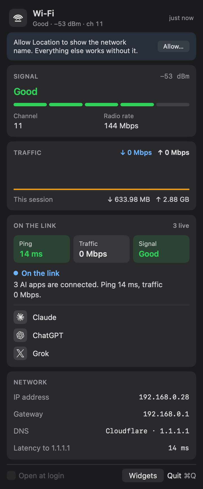
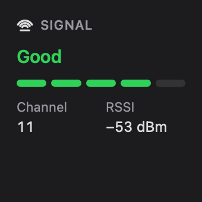
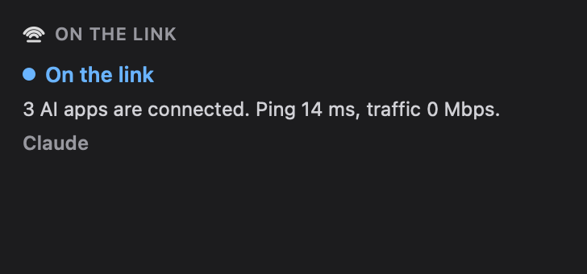
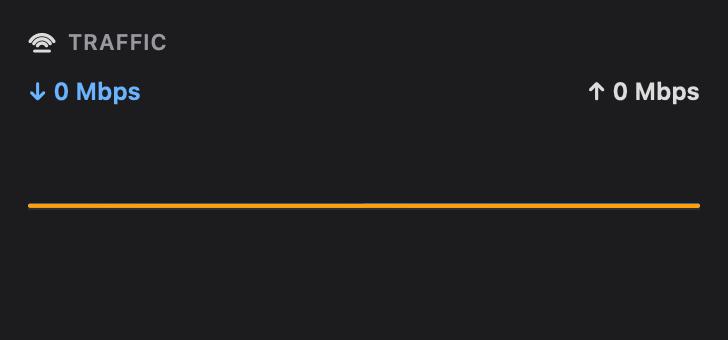

<p align="center">
  
</p>

<h1 align="center">Airtime</h1>

<p align="center">
  Live Wi-Fi in the macOS menu bar. When an LLM fills the pipe, you’ll know why the ping moved.
</p>

<p align="center">
  <a href="https://github.com/tomymaritano/devwibar/releases/latest"></a>
  
  
</p>

```bash
brew tap tomymaritano/tap
brew install --cask devwibar
```

Native Swift. No Electron. No Dock icon. Same idea as the [`devwifi`](https://github.com/tomymaritano/devwifi) CLI — always visible, one click deep.

<p align="center">
  
</p>

<p align="center">
  
</p>

## What you get

**Menu bar** — a wifi-on-a-bar mark. Template white, native. Click it.

**Signal** — RSSI quality (Excellent / Good / Fair / Weak / Very Weak) on a five-segment meter, channel, radio rate. Same cutoffs as `devwifi`.

**Traffic** — download and upload as two series on one shared scale, blue for download and orange for upload, so the two are comparable at a glance. Session totals below.

**On the link** — LLM Connection Radar. It attributes traffic to AI apps already on your Mac (Cursor, Claude, Grok, ChatGPT, Copilot, Gemini, Windsurf, Ollama, Perplexity) and says whether lag is Wi-Fi or an LLM saturating the uplink.

Evidence is three chips — Ping, Traffic, Signal — plus a one-line reason with numbers. No slogan rewrite. Process names and destinations only; nothing inside TLS.

**Network** — IP, gateway, DNS (Cloudflare / Google / Quad9 / OpenDNS labels), latency to 1.1.1.1. Click a value to copy.

**Latency** — optional ping sparkline to 1.1.1.1. Off by default; turn it on in Widgets.

**Footer** — Open at login, Widgets, Quit.

## Colour

Colour is semantic, not branding. Green means a healthy signal and low ping. Orange means a weak signal, the uplink is loaded, or latency is running high. Red means a very weak signal. Blue means download. Fair signal stays uncoloured on purpose — colour means "look at this," and Fair is neither good nor bad.

## Widgets

Click **Widgets** for a list of switches, same idea as adding Desktop widgets: each row is a different density. Turn it on to put that info in the panel; off to take it out.

<p align="center">
  
  
  
</p>

| Widget | What it adds |
| --- | --- |
| Metric | One number: RSSI + quality |
| Signal | Five-segment meter, channel, RSSI |
| History | RX/TX sparkline and totals |
| Combined | Signal + traffic + ping in one block |
| Latency | Ping sparkline |
| On the link | LLM radar |
| Network | IP, gateway, DNS |

The same templates appear in the macOS widget gallery (Desktop / Notification Center) when the `.appex` is embedded.

macOS: right-click the desktop or open Notification Center → Edit Widgets → Airtime.

System widgets refresh about every five minutes. Radar only appears after Airtime has written a snapshot (it will not run `lsof` inside the widget sandbox). If the gallery is empty, build with full Xcode so `package_app.sh` can embed `DevWifiBarWidgets.appex`.

Homebrew ships v0.2.1 (Developer ID signed and notarized). Upgrade with `brew upgrade --cask devwibar`.

## Install

### Homebrew

```bash
brew tap tomymaritano/tap
brew install --cask devwibar
open -a DevWifiBar
```

The cask lives in [`tomymaritano/homebrew-tap`](https://github.com/tomymaritano/homebrew-tap). Upgrade with `brew upgrade --cask devwibar`. v0.2.1 on the tap is still `DevWifiBar.app`. The next release installs as Airtime.

Releases are Developer ID signed and notarized. Gatekeeper opens them without right-click → Open.

### From source

macOS 14+ and Swift 5.10+ (Xcode 15.4 or later).

```bash
git clone https://github.com/tomymaritano/devwibar.git
cd devwibar
./Scripts/package_app.sh
open dist/Airtime.app
```

`make package` is the same. `UNIVERSAL=1 make package` builds arm64 + x86_64.

## Permissions

| Access | Why |
| --- | --- |
| **Location** | Apple only exposes SSID / BSSID through CoreWLAN + CoreLocation. Asked once. Without it the panel still shows RSSI, IP, traffic, DNS, and latency; the name stays “Wi-Fi”. |
| **lsof / nettop** | Radar maps process names to known LLM hosts. No packet payloads, no keychain, no prompts. |

System Settings → Privacy & Security → Location Services → Airtime.

## How it works

| Data | Source |
| --- | --- |
| SSID, RSSI, channel, BSSID | CoreWLAN |
| SSID permission | CoreLocation |
| Path up/down | Network.framework (`NWPathMonitor`) |
| RX / TX bytes | `getifaddrs` interface counters |
| IP / gateway / DNS | `ipconfig`, `route`, `SCDynamicStore` |
| Latency | `ping` to 1.1.1.1 |
| AI apps on the link | `lsof` + `nettop`, matched against [`AICatalog`](Sources/DevWifiCore/AICatalog.swift) |

`DevWifiCore` is the readers and the widget snapshot. `DevWifiBar` is an `LSUIElement` AppKit status item + SwiftUI popover. `DevWifiBarWidgets` is the WidgetKit extension.

Radar rules (with hysteresis): latency is high above **80 ms** and clears below **60 ms**; saturate above **2.5 Mbps** and clears below **1.6 Mbps**. If ping is high and signal is Excellent, the verdict is uplink / LLM host — not RSSI. If `lsof` does not exit, the verdict is that the link could not be read. An empty answer is Quiet.

## Development

```bash
swift test
swift build -c release --product DevWifiBar
make package
make widgets          # XcodeGen + WidgetKit extension (full Xcode)
```

GitHub Actions (`macos-14`) runs tests and an ad-hoc package on every push to `main`. A tag `vX.Y.Z` (or **Release** → Run workflow) signs with Developer ID, notarizes, and attaches `Airtime-X.Y.Z.zip` to the GitHub Release.

## Phase 2

Password reveal, QR share, speed test, DNS switching, device scan, and alerts stay in the [`devwifi`](https://github.com/tomymaritano/devwifi) CLI for now.

## License

MIT. Provider marks in the radar are [Simple Icons](https://simpleicons.org) (CC0); trademarks belong to their owners.
